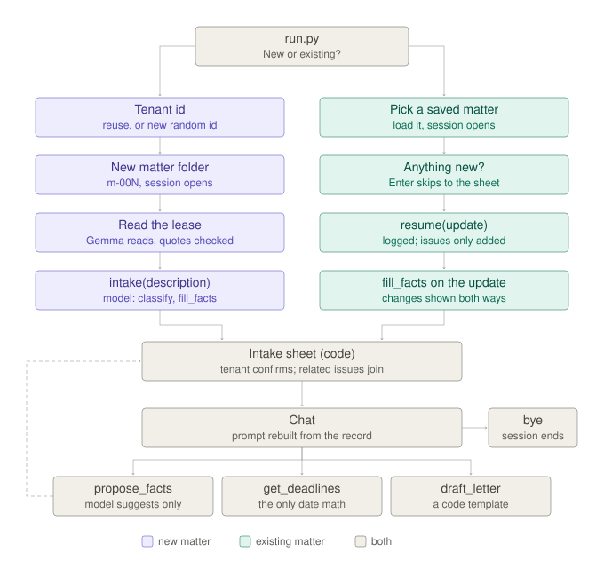
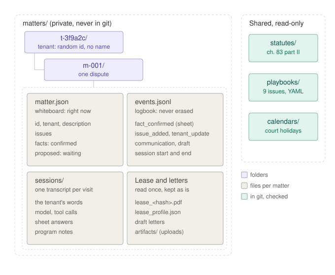

# Structure as of 2026-09-28

A dated snapshot. It is not kept current; DOCUMENTATION.md is. A later snapshot gets its own dated file.

## How a session works

Purple is a new tenant or dispute, teal a returning one; both meet at the intake sheet. The dashed arrow is
the loop in the chat: when the model hears a new fact it can only suggest it (`propose_facts`), and the sheet
comes back so the tenant confirms it. Model calls happen in four places: reading the lease (Gemma), `intake`,
`resume`, and the chat. Everything else is code.

## Where data is stored

Each tenant's data stays in its own folder under `matters/`, named by a random id, never in git. The
shared material on the right is read-only, kept in git, and checked by `smoke.py`.

## Skills: the original plan and what was built

The original plan (README part 3 and the early TODO items):

1. Only a short index of issues in the prompt; the model calls a `load_skill(issue)` tool to pull in an
   issue's guidance and statute sections when it decides it needs them.
2. `related_issues` as data, so a confirmed fact can bring in a second issue mid-conversation.
3. Statute sections loaded on demand too.

What was built instead, with the same aim (only what the matter needs in front of the model), decided by
code rather than by the model:

1. The system prompt is rebuilt from the record before every model call (`dynamic_prompt`). The guidance
   and statute sections of every active issue are in it and current; an issue that joins mid-chat is there
   on the model's next reply.
2. Related issues are data code acts on: a rule such as "received a notice = yes" is checked when the tenant
   confirms the fact on the sheet, the issue is added through `add_issues` (the only way an issue is added),
   logged, and its questions come up in the same sheet.
3. Each playbook names its own statute sections (`sections`), checked against `statutes/` at load; the
   unverified `ROUTING` section lists were retired.

`load_skill` was dropped: a tool the model calls is a tool it can forget to call, or call too late, and
answer without the issue's guidance. Code puts an issue's guidance in the prompt when the issue becomes
active, which meets the README's aim. A model-called loader would only be worth adding if matters grew to
many active issues at once.
